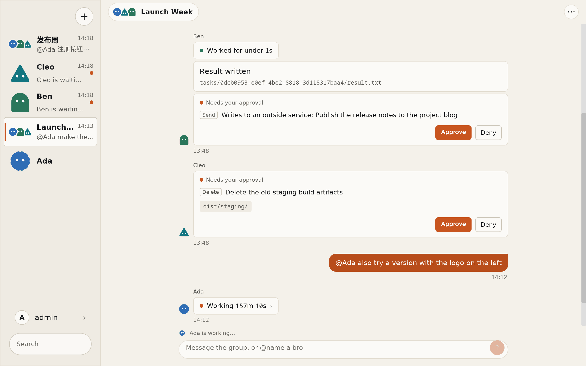
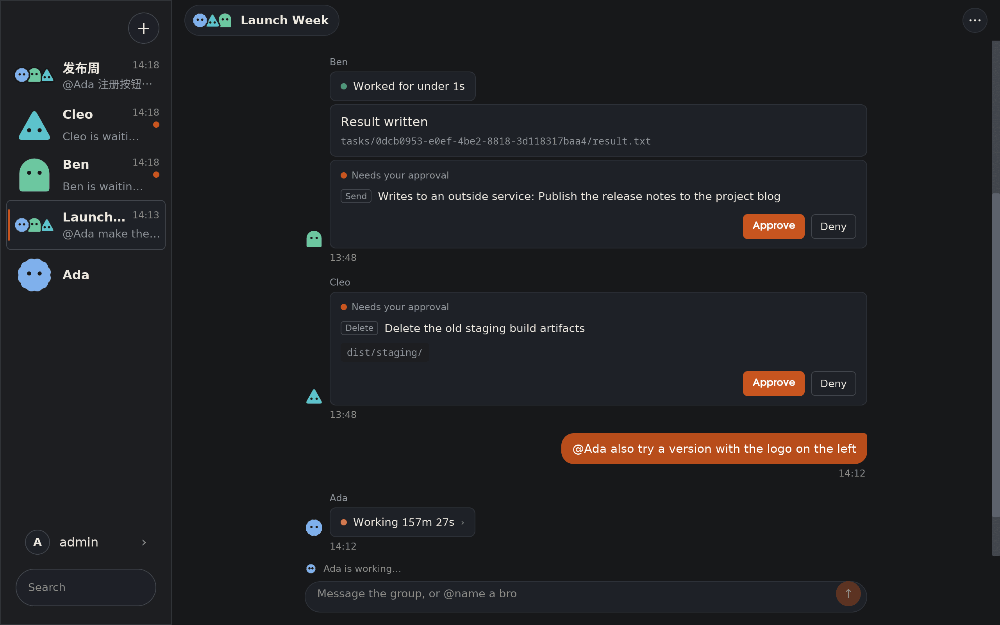
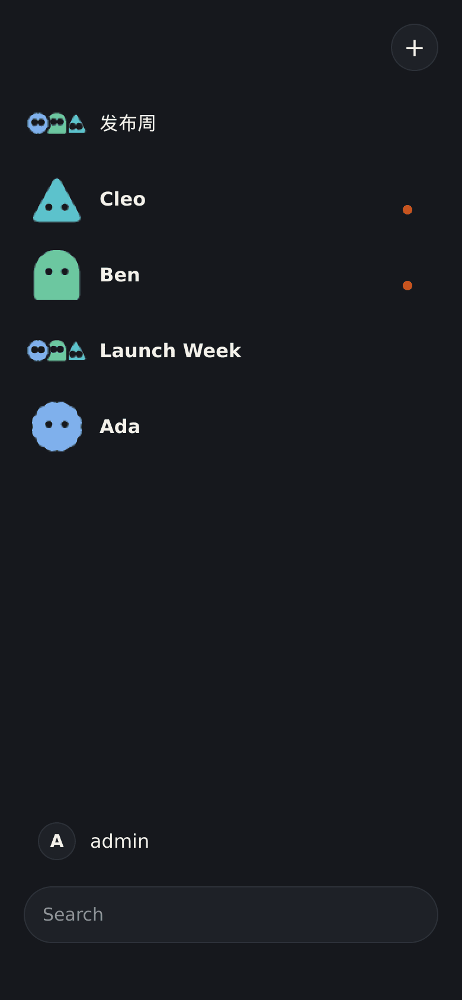
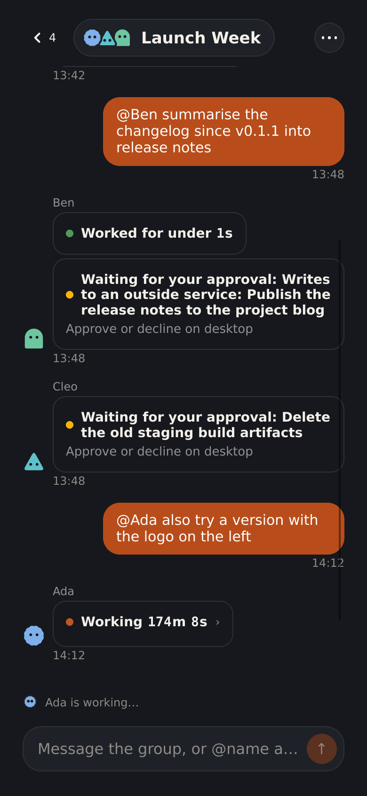
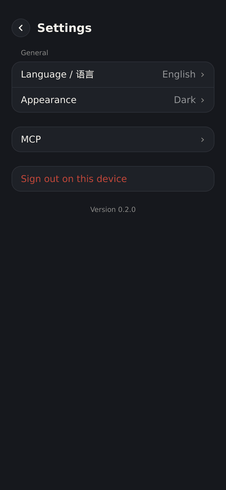

<p align="center">
  <picture>
    <source media="(prefers-color-scheme: dark)" srcset="assets/brand/wordmark-dark.svg">
    
  </picture>
</p>

<p align="center"><b>English</b> | <a href="README.zh-CN.md">简体中文</a></p>

<p align="center">
  <a href="https://github.com/PandaQuQ/robroz-client/actions/workflows/ci.yml"></a>
</p>

> This repository is the robroz **client**: the native desktop app (Windows, Linux, macOS) and the mobile app (Android, iOS). The host (server), the runner, the API contract and the Docker images are in [PandaQuQ/robroz](https://github.com/PandaQuQ/robroz). The client needs a running host.

A self-hosted multi-agent workspace operated through chat. Agents (bros) run in Docker sandboxes; approvals and results are returned as cards. This repository contains the native clients, written in Rust.

See [CHANGELOG.md](CHANGELOG.md) and [docs/install.md](docs/install.md).

## Overview

robroz is a self-hosted workspace in which you assign work, in plain language, to a group of AI bros on your own machine. The bros carry out that work in a sandbox on that machine and request approval before any risky step.

It is intended for people who want several AI agents in one workspace they control, and who want to approve risky steps themselves.

<p>
  
  
</p>

<sub>The Launch Week group in the desktop client, in the light and dark themes. Demo data.</sub>

The desktop client UI defaults to English. The language can be switched to 中文 under Settings, General, Language / 语言. Settings can be opened from your name at the bottom of the chat list. `ROBROZ_LANG=en|zh` overrides the saved choice for one run and is not written back. See [docs/configuration.md](docs/configuration.md) for the saved `lang` file.

Under Language is an Appearance / 「外观」 row that opens a list: System / 「跟随系统」, Light / 「浅色」, and Dark / 「深色」. The default is System, which follows the operating system as it changes. The choice is saved as one line (`system`, `light`, or `dark`) in a `theme` file next to `lang`.

<p>
  
  
  
</p>

<sub>The same workspace in the mobile client (dark theme). Approval cards on the phone are read-only. Demo data.</sub>

## Features

- **Chat bubbles.** Your messages appear on the right; bro cards appear on the left, grouped by sender. A delivery with a `bot_name` is attached to that bro; a delivery without one stands alone.
- **Group turns.** A message that names no bro receives one reply, from one bro selected by the host. Name a bro with `@name` at the start and that bro speaks first; the others may then take a turn or remain silent.
- **Bros reply to each other.** When a bro replies in a group, the other bros may also reply. The exchange stops after two rounds.
- **Follow-ups.** If a bro is still working, further instructions can be added to that work instead of starting a new task. In a group, start the message with `@name`; in a direct message, send the message without a mention.
- **Multi-step tasks.** A bro can split a task into up to 3 steps; the card shows "Step n of m".
- **Direct messages.** One-to-one conversation with a bro.
- **Docker sandbox.** Each job runs in a container on your machine, without network access.
- **Approvals and Allow rules.** Risky steps require your approval. Auto-review checks each card against your allow rules; if no rule allows it, the card stays where the task started and you approve or deny it. For a card in a group, a reminder is also sent in your direct message with the bro. Memory and skill changes also require confirmation.
- **Model settings.** Any OpenAI-compatible model can be connected. A base URL and a model name are sufficient; the key is optional. Settings can be applied in the client or with environment variables.

Web search (Brave or SearXNG), MCP tools, and scheduled routines are also available. When a step runs long or stalls, a hint appears on the card; the work is not cancelled.

## Roadmap

The following items are accepted design or are in progress. They are **not** shipped on `main`. Details: [design/multi-agent.md](https://github.com/PandaQuQ/robroz/blob/main/docs/design/multi-agent.md) in the host repository.

- Cancelling a timed-out step or stopping the container.

## Installation

A Rust stable toolchain (`rustup`, `cargo`) and a running host are required. To start a host, follow the [Installation](https://github.com/PandaQuQ/robroz#installation) section in PandaQuQ/robroz; it listens on `127.0.0.1:8790` by default. To install a published client binary instead of building from source, see [docs/install.md](docs/install.md).

```sh
cargo run -p robroz-client   # default host http://127.0.0.1:8790
cargo run -p robroz-client -- --fake   # look at the UI without a host
```

For a host on another machine, fill in Host and Token under Connection (「连接」) in Settings, or set `ROBROZ_HOST` and `ROBROZ_TOKEN` for one run. See [docs/install.md](docs/install.md#run-the-client).

## Quick start

In the client, click the + at the top of the chat list (Add a bro, 「引入一个 bro」), enter a name and press Add (「引入」), open the DM and send a message. That is your first task. With no model configured, the delivery is No model set up yet (「还没设置模型」) and the card offers Set up (「去设置」). Open Settings, Bros, Model (「模型」), or that link, fill in the address and the model name, and save; the key is optional and is stored by the host, not by the client.

## Documentation

Repository docs are the contract; when the [wiki](https://github.com/PandaQuQ/robroz/wiki) disagrees, the repositories win. Rules for contributors and coding agents: [AGENTS.md](AGENTS.md).

| File | Contents |
| --- | --- |
| [CHANGELOG.md](CHANGELOG.md) | Release notes |
| [docs/install.md](docs/install.md) | Download a release, build, run the client, connect to a host |
| [docs/configuration.md](docs/configuration.md) | Client environment variables and saved preferences |
| [docs/client.md](docs/client.md) | Client UI behaviour |
| [mobile/README.md](mobile/README.md) | Building the mobile client |

The API, cards, permissions, approvals, memory, skills, search, MCP and the host's configuration are documented in the [host repository's docs](https://github.com/PandaQuQ/robroz/tree/main/docs).

## Status

This repository has not yet published a release; build the client from source (see [Installation](#installation)). v0.1.1 and earlier were published from the [host repository](https://github.com/PandaQuQ/robroz/releases). `main` targets the [v0.2.0 host](https://github.com/PandaQuQ/robroz/releases/tag/v0.2.0) and `contract-v0.3.1`.

## Architecture

The desktop client (`robroz-client`, [iced](https://iced.rs/) 0.14, no web view) talks to the host (`robroz-host`) over HTTP and SSE. Request, response and card types come from `robroz-contract` in the host repository, pinned by git tag (`contract-v*`) in `Cargo.toml`. The client's `against_host` tests build that host from the same tag, so no Docker is needed to test the client. How the host side fits together: [architecture.md](https://github.com/PandaQuQ/robroz/blob/main/docs/architecture.md).

| Path | Crate | Role |
| --- | --- | --- |
| `client/` | `robroz-client` | iced desktop client |
| `mobile/` | `robroz-mobile` | Mobile client (Android and iOS); see [mobile/README.md](mobile/README.md) |
| `crates/robroz-card` | `robroz-card` | Card status text, tone and actions |
| `crates/robroz-tokens` | `robroz-tokens` | Design tokens generated from `tokens.json` |
| `crates/robroz-ui` | `robroz-ui` | Shared client UI layer and theme |

"Bro" is the UI name for a bot: code, API and the database still say bot (`botId` / `botName`). The four task states `queued` / `running` / `blocked` / `done` are frozen.

## Development

Run the same commands as CI before opening a pull request:

```sh
cargo build -p robroz-client
cargo test -p robroz-client -p robroz-card -p robroz-ui -p robroz-tokens
```

CI builds and tests the client on Linux for pull requests, and on Windows, Linux and macOS after merging to `main` and on a nightly schedule. A separate workflow builds the Android APK and an unsigned iOS app. A `cargo-deny` job checks that new dependencies use an AGPL-compatible licence and come from a known registry; advisories are reported and do not block the merge. Run the same checks locally after installing [cargo-deny](https://github.com/EmbarkStudios/cargo-deny):

```sh
cargo deny check licenses bans sources
cargo deny check advisories   # reported, does not block merging
```

## Contributing

- One pull request per change.
- Every contributor must sign the [Contributor License Agreement](CLA.md) once: tick the CLA checkbox in the pull request template, or add the CLA line from `CLA.md` to the pull request body. Pull requests without it are not merged.
- Commit messages and pull request titles and bodies are in English and follow [Conventional Commits](https://www.conventionalcommits.org/): `feat(client): …`, `fix(mobile): …`, `docs: …`. Pull requests are squash-merged with the title as the commit message.
- Contract changes go to the host repository first; this repository then moves to the new `contract-v*` tag.
- `main` is protected: changes land only through a pull request, and the three CI checks (`client (ubuntu-latest)`, `cargo-deny`, `cla`) must pass before merge. No one can bypass this, admins included.
- No force-push. If your branch is behind, merge `main` into it.
- Never commit `.env`, `.pem`, `.dev.vars`, keys or tokens.
- Keep `README.md` and `README.zh-CN.md` in sync; change both in the same pull request.

The full rules are in [AGENTS.md](AGENTS.md).

## License

SPDX-License-Identifier: `AGPL-3.0-only`

The client is licensed only under the [GNU Affero General Public License v3.0 only](LICENSE). If you modify it and let others use it over a network, you must offer them your modified source code (AGPL section 13). No commercial licence is offered for the client; the commercial licence covers the host in [PandaQuQ/robroz](https://github.com/PandaQuQ/robroz).

Contributions are accepted under the [Contributor License Agreement](CLA.md).
