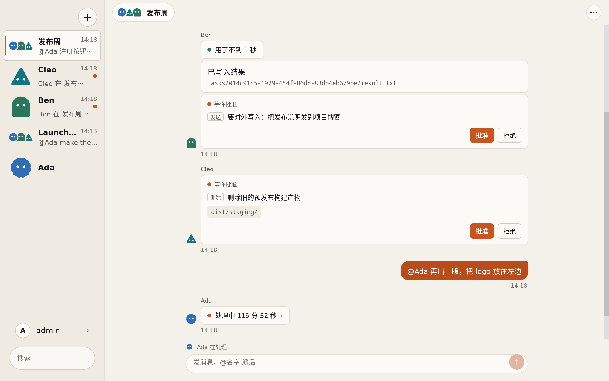
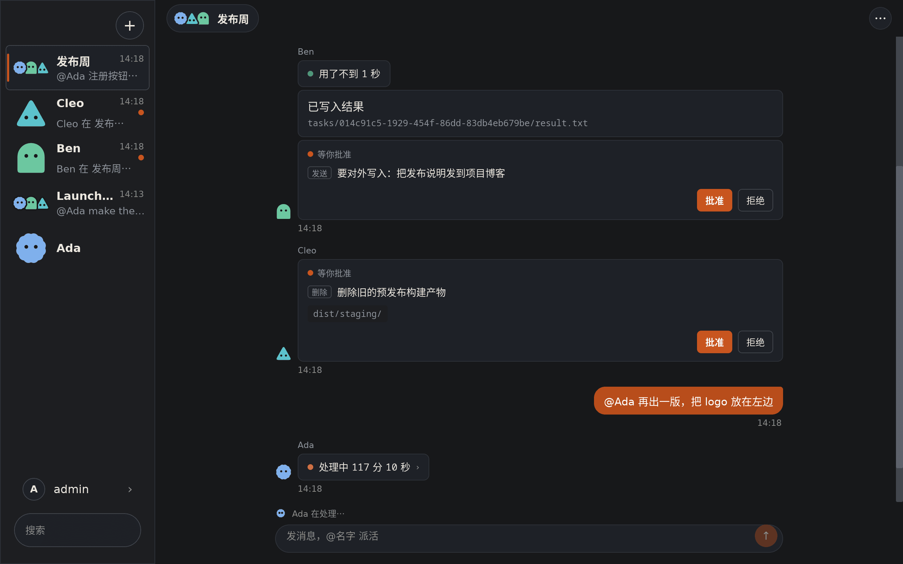
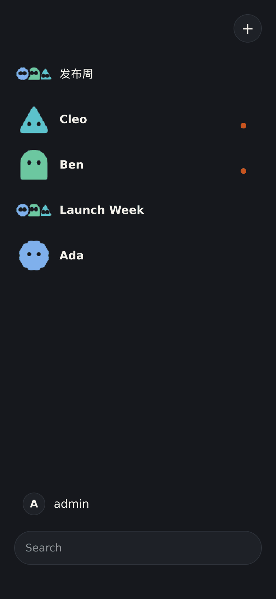
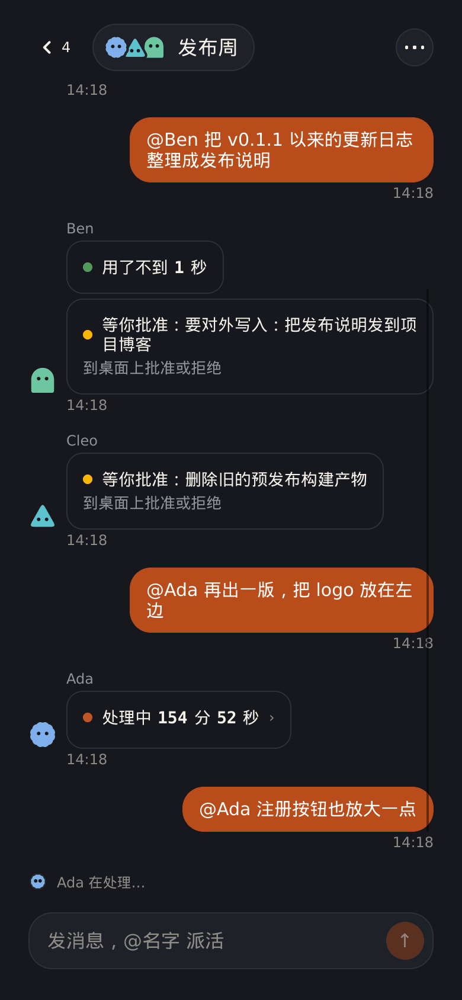
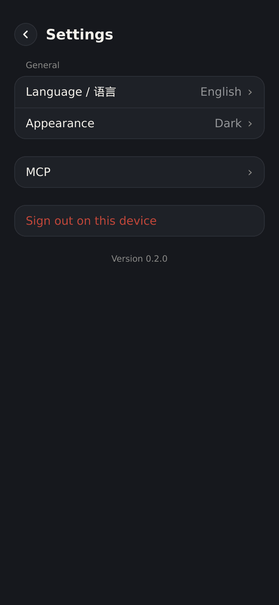

<p align="center">
  <picture>
    <source media="(prefers-color-scheme: dark)" srcset="assets/brand/wordmark-dark.svg">
    
  </picture>
</p>

<p align="center"><a href="README.md">English</a> | <b>简体中文</b></p>

<p align="center">
  <a href="https://github.com/PandaQuQ/robroz-client/actions/workflows/ci.yml"></a>
</p>

> 本仓库是 robroz **客户端**：原生桌面应用（Windows、Linux、macOS）和手机应用（Android、iOS）。宿主机（服务端）、runner、接口契约和 Docker 镜像在 [PandaQuQ/robroz](https://github.com/PandaQuQ/robroz)。客户端需要连接一个正在运行的宿主机。

自托管的多智能体工作台，通过对话进行操作。智能体（bro）在 Docker 沙箱中运行；审批和结果以卡片返回对话。本仓库是原生客户端，用 Rust 编写。

见 [CHANGELOG.md](CHANGELOG.md) 和 [docs/install.md](docs/install.md)。

## 概览

在自己的机器上，通过对话向一组 AI bro 布置工作。工作以自然语言描述，在本机沙箱中执行；遇有风险的步骤会先征求批准。

适合希望在自己控制的工作区中使用多个 AI 智能体、并由自己批准风险步骤的用户。

<p>
  
  
</p>

<sub>桌面客户端中的「发布周」群，浅色与深色主题。演示数据。</sub>

桌面客户端界面默认是英文。要切换到中文，到设置的「通用」里选择「Language / 语言」。设置从聊天列表底部你的名字那一行进入。`ROBROZ_LANG=en|zh` 只对这一次运行生效，不会写回已保存的选择。保存的 `lang` 文件见 [docs/configuration.md](docs/configuration.md)。

语言那一行下面是 Appearance / 「外观」，打开后是一个列表：System / 「跟随系统」、Light / 「浅色」、Dark / 「深色」。默认是 System，会跟随操作系统实时切换。选择保存在 `lang` 旁边的 `theme` 文件里，一行，值为 `system`、`light` 或 `dark`。

<p>
  
  
  
</p>

<sub>同一工作区在手机客户端中的样子（深色主题）。手机上的审批卡为只读。演示数据。</sub>

## 功能

- **聊天气泡。** 你自己的消息显示在右边；bro 的卡片显示在左边，按发送者分组。带 `bot_name` 的交付卡挂到对应的 bro 下面；没有 `bot_name` 的单独一条。
- **群轮次。** 没有点名时，群消息只由宿主选出的一个 bro 回复。消息开头用 `@name` 点名的那个 bro 先说，其他 bro 可以接着发言，也可以保持沉默。
- **bro 相互回复。** bro 在群里回复后，其他 bro 也可以接着回复，最多两轮后停止。
- **追问。** 如果一个 bro 仍在执行任务，可以在该任务上补充说明，而不新开任务。在群里以 `@name` 开头；在私聊里直接发送即可。
- **分步任务。** 最多拆成 3 步，卡片显示「n/m 步」。
- **私聊。** 可以和一个 bro 单独对话。
- **Docker 沙箱。** 每份工作在你机器上的一个容器里运行，容器没有网络。
- **审批和放行规则（Allow rules）。** 有风险的步骤会先征求你的批准。自动审核会按你的放行规则检查每张卡；没有规则放行时，卡留在任务发起的地方，由你批准或拒绝。卡在群里时，你和这个 bro 的私聊里还会收到一条提醒。记忆和技能的变更也要先经你确认。
- **模型设置。** 可以连接任意 OpenAI 兼容的模型。填写地址和模型名即可完成配置，密钥可选。可以在客户端设置，也可以使用环境变量。

还可以使用联网搜索（Brave 或 SearXNG）、MCP 工具和例行任务。某一步运行过久或停滞时，卡片上会出现一行提示；工作本身不会被取消。

## 路线图

以下项目为已接受的设计，或正在进行，**尚未**合并到 `main`。细节见宿主机仓库的 [design/multi-agent.md](https://github.com/PandaQuQ/robroz/blob/main/docs/design/multi-agent.md)。

- 超时后取消步骤或停掉容器。

## 安装

需要 Rust stable 工具链（`rustup`、`cargo`）和一个正在运行的宿主机。启动宿主机请按 [PandaQuQ/robroz 的安装说明](https://github.com/PandaQuQ/robroz#installation) 操作，默认监听 `127.0.0.1:8790`。若要安装已发布的客户端二进制而不从源码构建，见 [docs/install.md](docs/install.md)。

```sh
cargo run -p robroz-client   # 默认连接 http://127.0.0.1:8790
cargo run -p robroz-client -- --fake   # 不连宿主机，只看界面
```

宿主机在其他机器上时，到设置的 Connection（「连接」）里填写 Host 和 Token，或者只对这一次运行设置 `ROBROZ_HOST` 和 `ROBROZ_TOKEN`。见 [docs/install.md](docs/install.md#run-the-client)。

## 快速开始

在客户端聊天列表顶部点 +（Add a bro，「引入一个 bro」），输入名称再点「引入」，打开私聊并发送一条消息，即为第一个任务。尚未配置模型时，交付是 No model set up yet（「还没设置模型」），卡片上有 Set up（「去设置」）。打开设置，在「bro」一组里点 Model（「模型」），或点这个链接，填写地址和模型名后保存；密钥可选，由宿主机保存，客户端不保存。

## 文档

仓库中的文档为契约；[wiki](https://github.com/PandaQuQ/robroz/wiki) 与仓库不一致时，以仓库为准。给贡献者和编码 agent 的规则见 [AGENTS.md](AGENTS.md)。

| 文件 | 内容 |
| --- | --- |
| [CHANGELOG.md](CHANGELOG.md) | 发版说明 |
| [docs/install.md](docs/install.md) | 下载发布版、构建、运行客户端、连接宿主机 |
| [docs/configuration.md](docs/configuration.md) | 客户端的环境变量和保存的偏好 |
| [docs/client.md](docs/client.md) | 客户端界面行为 |
| [mobile/README.md](mobile/README.md) | 构建手机客户端 |

接口、卡片、权限、审批、记忆、技能、搜索、MCP 和宿主机配置，见[宿主机仓库的文档](https://github.com/PandaQuQ/robroz/tree/main/docs)。

## 状态

本仓库尚未发布版本，请从源码构建（见[安装](#安装)）。v0.1.1 及以前从[宿主机仓库](https://github.com/PandaQuQ/robroz/releases)发布。`main` 对应 [v0.2.0 宿主机](https://github.com/PandaQuQ/robroz/releases/tag/v0.2.0)和 `contract-v0.3.1`。

## 架构

桌面客户端（`robroz-client`，[iced](https://iced.rs/) 0.14，不套网页）通过 HTTP 和 SSE 连接到宿主机（`robroz-host`）。请求、返回和卡片类型来自宿主机仓库的 `robroz-contract`，在 `Cargo.toml` 里按 git tag（`contract-v*`）固定。客户端的 `against_host` 测试按同一个 tag 构建宿主机，因此测试客户端不需要 Docker。宿主机一侧如何配合见 [architecture.md](https://github.com/PandaQuQ/robroz/blob/main/docs/architecture.md)。

| 路径 | crate | 作用 |
| --- | --- | --- |
| `client/` | `robroz-client` | iced 桌面客户端 |
| `mobile/` | `robroz-mobile` | 手机客户端（Android 和 iOS），见 [mobile/README.md](mobile/README.md) |
| `crates/robroz-card` | `robroz-card` | 卡片的状态文案、色调和动作 |
| `crates/robroz-tokens` | `robroz-tokens` | 由 `tokens.json` 生成的设计 token |
| `crates/robroz-ui` | `robroz-ui` | 客户端共用的界面层和主题 |

「bro」是界面上的称谓，代码、接口和数据库中仍称为 bot（`botId` / `botName`）。四个任务状态 `queued` / `running` / `blocked` / `done` 已冻结。

## 开发

提交 pull request 前，请运行与 CI 相同的命令：

```sh
cargo build -p robroz-client
cargo test -p robroz-client -p robroz-card -p robroz-ui -p robroz-tokens
```

CI 在 pull request 上只构建和测试 Linux 客户端；合并到 `main` 后以及每天定时会再运行 Windows、Linux、macOS。另有一个工作流构建 Android APK 和未签名的 iOS 应用。`cargo-deny` 任务检查新依赖的许可证是否与 AGPL 兼容、来源是否为已知 registry；安全公告只报告，不阻止合并。安装 [cargo-deny](https://github.com/EmbarkStudios/cargo-deny) 后可以在本地运行同样的检查：

```sh
cargo deny check licenses bans sources
cargo deny check advisories   # 只报告，不挡合并
```

## 参与贡献

- 一个 pull request 只做一件改动。
- 每位贡献者都要签一次[贡献者许可协议](CLA.md)：勾选 pull request 模板里的 CLA 选项，或把 `CLA.md` 里的那行声明加到 pull request 正文。没有签署的 pull request 不会合并。
- 提交信息、pull request 标题和正文都用英文，按 [Conventional Commits](https://www.conventionalcommits.org/) 写：`feat(client): …`、`fix(mobile): …`、`docs: …`。pull request 用 squash 合并，标题就是提交信息。
- 契约改动须先提交到宿主机仓库；本仓库随后更新到新的 `contract-v*` tag。
- `main` 受保护：只能通过 pull request 合入，三个 CI 检查（`client (ubuntu-latest)`、`cargo-deny`、`cla`）全部通过才能合并，管理员也不能绕过。
- 不 force-push。分支落后时把 `main` merge 进来。
- 不提交 `.env`、`.pem`、`.dev.vars`、密钥或令牌。
- `README.md` 和 `README.zh-CN.md` 保持同步，在同一个 pull request 里一起改。

完整规则见 [AGENTS.md](AGENTS.md)。

## 许可证

SPDX-License-Identifier: `AGPL-3.0-only`

客户端只按 [GNU Affero General Public License v3.0 only](LICENSE) 授权。修改后通过网络让别人使用，就要向他们提供修改后的源代码（AGPL 第 13 条）。客户端不提供商业授权；商业授权只覆盖 [PandaQuQ/robroz](https://github.com/PandaQuQ/robroz) 里的宿主机。

贡献按[贡献者许可协议](CLA.md)接受。
